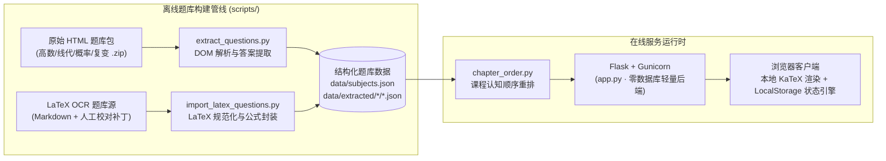

<a id="top"></a>

<div align="center">


<a href="https://mathe.kawwaii.de">
  
</a>

<p>
  <a href="https://mathe.kawwaii.de"></a>
  <a href="https://www.python.org/"></a>
  <a href="https://flask.palletsprojects.com/"></a>
  <a href="https://katex.org/"></a>
  
  
  
  <a href="https://github.com/Mufumoca/math/stargazers"></a>
</p>

<p>
  <strong>
    <a href="https://mathe.kawwaii.de">🌐 在线体验</a> ·
    <a href="#features">✨ 核心特性</a> ·
    <a href="#dataset">📚 题库概览</a> ·
    <a href="#shortcuts">⌨️ 快捷键</a> ·
    <a href="#architecture">🏗️ 架构设计</a> ·
    <a href="#quickstart">🚀 快速开始</a> ·
    <a href="#deployment">📦 生产部署</a> ·
    <a href="https://github.com/Mufumoca/math/issues">🐞 问题反馈</a>
  </strong>
</p>

<p>
  <a href="https://github.com/Mufumoca/math" title="Moe Visitor Counter">
    
  </a>
</p>

</div>

---

## 📖 项目简介

**Math** 是一个专为大学数学期末复习与考研高强度刷题打造的**极简无干扰刷题工作台**。

早期原始题库（高等数学、线性代数、概率论、复变函数）散落在四个压缩包的章节 HTML 中，题干、选项、答案标记与推导解析全部嵌套在老旧表格与海量内联 Base64 位图里。本项目完成了完整的现代化重构：

1. **结构化与矢量公式迁移**：将全部 **8,220** 道题从模糊静态位图迁移为结构化 LaTeX JSON 数据，并对复杂矩阵、分段函数与积分推导进行了人工校对，彻底摆脱数万张碎图片依赖。
2. **认知顺序章节编排**：针对不同科目的知识脉络（见 `chapter_order.py`），对全部 **342** 个章节进行了符合教材认知逻辑的自动重排与标题规范化。
3. **零数据库纯净架构**：后端仅依赖轻量的 `Flask + Gunicorn` 读取静态结构化 JSON；前端采用原生 JavaScript + 本地内置 `KaTeX` 引擎，配合 `localStorage` 实现进度统计、断点续刷与错题自测，**克隆即跑、离线可用**。

---

<a id="dataset"></a>

## 📚 题库规模与科目概览

仓库内 `data/` 目录已内置完整转换后的 LaTeX 题库数据，无需额外下载即可直接运行：

| 序号 | 科目名称 | 路由标识 (`subject_id`) | 章节数（含题章节） | 收录题量 | 核心知识模块 |
| :---: | :--- | :--- | :---: | :---: | :--- |
| `01` | **高等数学** | `advanced-math` | 165（159） | **4,488** | 极限与连续、一元/多元微积分、无穷级数、空间解析几何、曲线曲面积分、常微分方程 |
| `02` | **概率论与数理统计** | `probability` | 132（108） | **1,601** | 随机事件与概率、一维/多维随机变量及分布、数字特征、大数定律与中心极限定理、数理统计 |
| `03` | **复变函数与积分变换** | `complex-analysis` | 28（27） | **1,296** | 复数与解析函数、Cauchy 积分定理与公式、Taylor/Laurent 级数、留数理论、保角映射、Laplace/Fourier 变换 |
| `04` | **线性代数** | `linear-algebra` | 17（17） | **835** | 行列式、Cramer 法则、矩阵运算与初等变换、线性方程组、向量组与线性空间、特征值与二次型 |
| **合计** | **4 门核心课程** | — | **342（311）** | **8,220** | **100% 配备标准答案与分步推导解析** |

---

<a id="features"></a>

## ✨ 核心特性

<table>
  <tr>
    <td width="50%" valign="top">
      <h3>🎯 沉浸式双模式刷题台</h3>
      <ul>
        <li><b>连刷 / 单题双视图</b>：支持每页 10 题连续扫题，也可一键切换「单题专注模式」逐题攻坚。</li>
        <li><b>即时判题与原位解析</b>：点选选项立即反馈对错；答错时卡片柔和提示并<b>自动平滑展开推导解析</b>，不弹窗、不打断视线。</li>
        <li><b>悬浮毛玻璃 HUD</b>：实时展示本章进度细线、题号状态矩阵（答对/答错/收藏着色），支持按 <code>全部 / 未答 / 错题 / 收藏</code> 一键过滤及重置本章记录。</li>
      </ul>
    </td>
    <td width="50%" valign="top">
      <h3>📐 纯本地矢量公式与现代视觉</h3>
      <ul>
        <li><b>离线级 KaTeX 引擎</b>：仓库自带 <code>katex.min.js</code> 与全套数学字体（<code>static/vendor/katex/</code>），零外部 CDN 依赖，分式、积分与大型矩阵清晰锐利、秒级渲染。</li>
        <li><b>三态外观无缝切换</b>：内置滑块分段控制器，支持 <b>浅色 / 跟随系统 / 深色</b> 模式，首屏防闪烁（Zero-FOUC），深色下公式对比度依然舒适柔和。</li>
        <li><b>全端自适应布局</b>：最佳 740px 专注阅读视口，桌面端支持侧边章节栏折叠记忆，移动端自动切换为抽屉式导航。</li>
      </ul>
    </td>
  </tr>
  <tr>
    <td width="50%" valign="top">
      <h3>📊 智能进度追踪与断点续刷</h3>
      <ul>
        <li><b>继续上次练习</b>：首页自动读取本地最近一次刷题进度，生成「继续上次练习」横幅一键直达原章节。</li>
        <li><b>科目与章节完成度看板</b>：自动汇总各科目已刷题数与实时正确率，章节列表支持关键词即时检索与 <code>全部 / 进行中 / 未开始 / 已完成</code> 四态筛选。</li>
      </ul>
    </td>
    <td width="50%" valign="top">
      <h3>★ 错题本与「重做自测」</h3>
      <ul>
        <li><b>结构化归档</b>：收藏题目自动按「科目 → 章节」分组聚合，支持跨浏览器标签页实时同步状态。</li>
        <li><b>重做自测 vs 显示答案</b>：默认开启<b>「重做自测模式」</b>遮挡原答案，重新点选检验真实掌握度；切换至<b>「显示答案模式」</b>则直接展开全部答案与解析用于考前速览，并支持一键跳回原章节锚点。</li>
      </ul>
    </td>
  </tr>
</table>

---

<a id="shortcuts"></a>

## ⌨️ 键盘快捷键

在章节刷题页（`/subjects/<subject_id>/chapters/<chapter_id>`）中，支持全键盘流作答，双手无需离开键盘：

| 快捷键 | 功能说明 | 备注 |
| :---: | :--- | :--- |
| <kbd>A</kbd> <kbd>B</kbd> <kbd>C</kbd> <kbd>D</kbd> | 选择当前激活题目的对应选项并立即判题 | 连刷模式下点击任意题卡即可切换激活题 |
| <kbd>Space</kbd> / <kbd>E</kbd> | 展开或收起当前题目的「推导与解析」 | 答错时也会自动为您展开解析 |
| <kbd>S</kbd> | 将当前题目加入收藏夹 / 取消收藏 | 顶部导航栏徽章会实时更新收藏总数 |
| <kbd>←</kbd> / <kbd>→</kbd> | 上一页 / 下一页（单题模式下为上一题 / 下一题） | 翻页后平滑回到视口顶部 |
| <kbd>[</kbd> | 展开或收起左侧本科目章节目录栏 | 桌面端自动记住折叠偏好 |

---

<a id="architecture"></a>

## 🏗️ 系统架构与项目结构



### 目录结构说明

```text
math/
├── app.py                        # Flask 核心应用路由、静态资源版本注入与 /healthz 健康检查
├── chapter_order.py              # 科目章节标题修正与教材认知顺序重排逻辑
├── requirements.txt              # Python 依赖（Flask / BeautifulSoup4 / Gunicorn）
├── run.sh                        # Gunicorn 生产启动脚本（自动适配 IPv4 / IPv6 绑定）
├── data/
│   ├── subjects.json             # 科目与章节总索引清单（4 门课、342 章、8,220 题）
│   └── extracted/                # 按科目划分的结构化章节题目 JSON
│       ├── advanced-math/        # 高等数学 (ch001.json ~ ch165.json)
│       ├── linear-algebra/       # 线性代数 (ch001.json ~ ch017.json)
│       ├── probability/          # 概率论与数理统计 (ch001.json ~ ch132.json)
│       └── complex-analysis/     # 复变函数与积分变换 (ch001.json ~ ch028.json)
├── templates/
│   ├── base.html                 # 全局顶栏、滑动导航胶囊、三态主题控制器与资源引入
│   ├── index.html                # 首页工作台（续刷横幅、数据看板、科目进度卡片）
│   ├── subject.html              # 科目详情页（章节实时搜索、完成状态四态过滤）
│   ├── chapter.html              # 沉浸式刷题页（可折叠目录栏、悬浮 HUD、题目流）
│   └── favorites.html            # 错题与重点收藏页（重做自测 / 显示答案双模式）
├── static/
│   ├── css/style.css             # 响应式设计系统与深浅色主题 Token
│   ├── js/app.js                 # 前端核心状态机（判题、快捷键、本地存储、KaTeX 渲染）
│   └── vendor/katex/             # 本地内置 KaTeX 引擎与全套 Web 数学字体
├── scripts/
│   ├── extract_questions.py      # 从原始 HTML 压缩包抽取题目结构
│   └── import_latex_questions.py # 将 OCR Markdown 转换为结构化 LaTeX JSON（含人工校对表）
└── deploy/
    ├── Caddyfile.example         # Caddy 自动 HTTPS 与反向代理示例配置
    └── math.service              # systemd 守护进程服务单元配置
```

<details>
<summary><b>🔍 点击展开：查看单题 JSON 数据结构与前端存储键值规范</b></summary>

<br>

**1. 章节题目 JSON 结构示例（`data/extracted/<subject_id>/chXXX.json`）**

```json
{
  "id": "q0001",
  "number": 1,
  "header": "#1-Averge",
  "difficulty": "Averge",
  "prompt_html": "<div class=\"math-tex math-block\" data-display=\"true\" data-tex=\"...\">...</div>",
  "options": [
    { "label": "A", "html": "<span class=\"math-tex\" data-display=\"false\" data-tex=\"...\">...</span>" },
    { "label": "B", "html": "..." },
    { "label": "C", "html": "..." },
    { "label": "D", "html": "..." }
  ],
  "answer": "C",
  "answer_index": 2,
  "analysis_html": "<div class=\"math-tex math-block\" data-display=\"true\" data-tex=\"...\">...</div>"
}
```

**2. 浏览器 `localStorage` 存储键说明**

| 存储键名 (`Key`) | 用途说明 |
| :--- | :--- |
| `theme-preference:v1` | 外观模式偏好（`light` / `dark` / `system`） |
| `quiz-view-mode:v1` | 刷题视图模式偏好（`page` 整页连刷 / `focus` 单题专注） |
| `quiz-sidebar-collapsed:v2` | 桌面端左侧章节栏折叠状态记忆 |
| `quiz-last-study:v1` | 最近一次练习的科目、章节、页码与直达链接（用于首页续刷横幅） |
| `quiz-progress:<subject>:<chapter>` | 对应章节内每道题的已选选项与正误状态记录 |
| `quiz-favorites:v1` | 收藏夹完整题目快照字典（支持离线查看与重做自测） |

</details>

---

<a id="quickstart"></a>

## 🚀 快速开始

> [!TIP]
> 仓库已完整内置 **8,220 道 LaTeX 题目 JSON** 与 **本地 KaTeX 静态资源**。无需安装任何数据库，也无需重新跑题库抽取脚本，拉取代码后 **30 秒内即可在本地启动**。

### 1. 环境准备

- **Python**：建议 `3.11` 及以上版本
- **操作系统**：Linux / macOS / Windows (WSL)

```bash
# 克隆仓库
git clone https://github.com/Mufumoca/math.git
cd math

# 创建虚拟环境并安装轻量依赖
python3 -m venv .venv
source .venv/bin/activate
pip install -r requirements.txt
```

### 2. 启动服务

**方式 A：Flask 开发模式启动**

```bash
HOST=127.0.0.1 PORT=5080 python app.py
```

**方式 B：Gunicorn 生产工作进程启动（推荐）**

```bash
HOST=127.0.0.1 PORT=5080 ./run.sh
```

启动后在浏览器访问：`http://127.0.0.1:5080/`

### 3. 环境变量与路由说明

`run.sh` 与 `app.py` 支持通过环境变量灵活控制监听行为：

| 环境变量 | 默认值 | 说明 |
| :--- | :---: | :--- |
| `HOST` | `::` | 监听地址（默认双栈/IPv6 `::`，仅本机反代推荐设为 `127.0.0.1`） |
| `PORT` | `5080` | 监听端口 |
| `WORKERS` | `2` | Gunicorn Worker 进程数量（仅 `run.sh` 生效） |
| `BIND` | 空 | 显式覆盖 Gunicorn `--bind` 参数（如 `unix:/run/math.sock`） |

**核心页面与接口路由：**

- `GET /` — 首页刷题工作台与总览看板
- `GET /subjects/<subject_id>` — 科目章节检索与学习进度页
- `GET /subjects/<subject_id>/chapters/<chapter_id>` — 章节沉浸式刷题页
- `GET /favorites` — 错题与重点收藏自测页
- `GET /healthz` — 服务存活健康检查（返回 `{"ok": true}`）

<details>
<summary><b>🛠️ 进阶维护：如何从原始题库重建或校对数据？（点击展开）</b></summary>

<br>

日常运行与二次开发前端**不需要**执行以下步骤。仅当你拥有新的上游题库源或希望批量重生成 JSON 时使用：

**1. 从 OCR LaTeX Markdown 目录重新导入**

默认读取上级目录 `../数学题库OCR_全部`（包含 `gs`、`xd`、`gl`、`fb_(1)` 子目录），并自动合并 `scripts/import_latex_questions.py` 中 `MANUAL_FIELD_OVERRIDES` 的人工公式勘误表：

```bash
source .venv/bin/activate
python scripts/import_latex_questions.py --ocr-dir ../数学题库OCR_全部
```

**2. 从早期 HTML 压缩包重新抽取**

若需从原始 `高数.zip`、`线代.zip`、`概率论.zip`、`复变.zip` 抽取原始数据：

```bash
source .venv/bin/activate
python scripts/extract_questions.py --source-dir ..
```

</details>

---

<a id="deployment"></a>

## 📦 生产环境部署

仓库 `deploy/` 目录已提供开箱即用的 `systemd` 与 `Caddy` 生产配置模板。

### 1. 配置 systemd 常驻守护

检查 `deploy/math.service` 中的 `WorkingDirectory` 与 `ExecStart` 路径（请确保与服务器实际克隆路径一致），然后安装并启用服务：

```bash
sudo cp deploy/math.service /etc/systemd/system/math.service
sudo systemctl daemon-reload
sudo systemctl enable --now math.service

# 查看运行状态与健康检查
systemctl status math.service
curl http://127.0.0.1:5080/healthz
```

### 2. 配置 Caddy 自动 HTTPS 反向代理

参考 `deploy/Caddyfile.example` 将站点接入 Caddy（自动申请并续期 Let's Encrypt 证书，支持 HTTP/3、Zstd/Gzip 压缩与 IPv4/IPv6 双栈访问）：

```caddy
mathe.kawwaii.de {
	encode zstd gzip

	header {
		Strict-Transport-Security "max-age=31536000; includeSubDomains"
		X-Content-Type-Options "nosniff"
		X-Frame-Options "SAMEORIGIN"
		Referrer-Policy "strict-origin-when-cross-origin"
	}

	reverse_proxy 127.0.0.1:5080
}
```

校验配置并热重载 Caddy：

```bash
sudo caddy validate --config /etc/caddy/Caddyfile
sudo systemctl reload caddy
```

---

## 🤝 参与贡献与题目勘误

非常欢迎任何形式的贡献！无论是界面交互优化、新功能提案，还是**题干/答案/LaTeX 公式的排版勘误**：

1. **题目公式勘误**：如果在刷题过程中发现某道题 OCR 识别有误，欢迎直接提交 [Issue](https://github.com/Mufumoca/math/issues) 注明「科目 + 章节 + 题号」，或在 `scripts/import_latex_questions.py` 的 `MANUAL_FIELD_OVERRIDES` / 对应 `data/extracted/` JSON 中修正后发起 Pull Request。
2. **代码贡献流程**：
   ```bash
   # 1. Fork 本仓库并克隆到本地
   # 2. 创建特性或修复分支
   git checkout -b feat/your-awesome-feature
   # 3. 提交改动并推送到你的分支
   git commit -m "Improve formula display on mobile"
   git push origin feat/your-awesome-feature
   # 4. 在 GitHub 上发起 Pull Request
   ```

### 贡献者们

<a href="https://github.com/Mufumoca/math/graphs/contributors">
  
</a>

---

## 📈 Star History

如果这个题库对你的期末复习或考研备考有帮助，欢迎点亮右上角的 **Star ⭐** 支持一下喵～

<div align="center">
  <a href="https://star-history.com/#Mufumoca/math&Date">
    <picture>
      <source media="(prefers-color-scheme: dark)" srcset="https://api.star-history.com/svg?repos=Mufumoca/math&type=Date&theme=dark" />
      <source media="(prefers-color-scheme: light)" srcset="https://api.star-history.com/svg?repos=Mufumoca/math&type=Date" />
      
    </picture>
  </a>
</div>

<div align="right">
  <a href="#top"><b>⬆️ 回到顶部</b></a>
</div>


